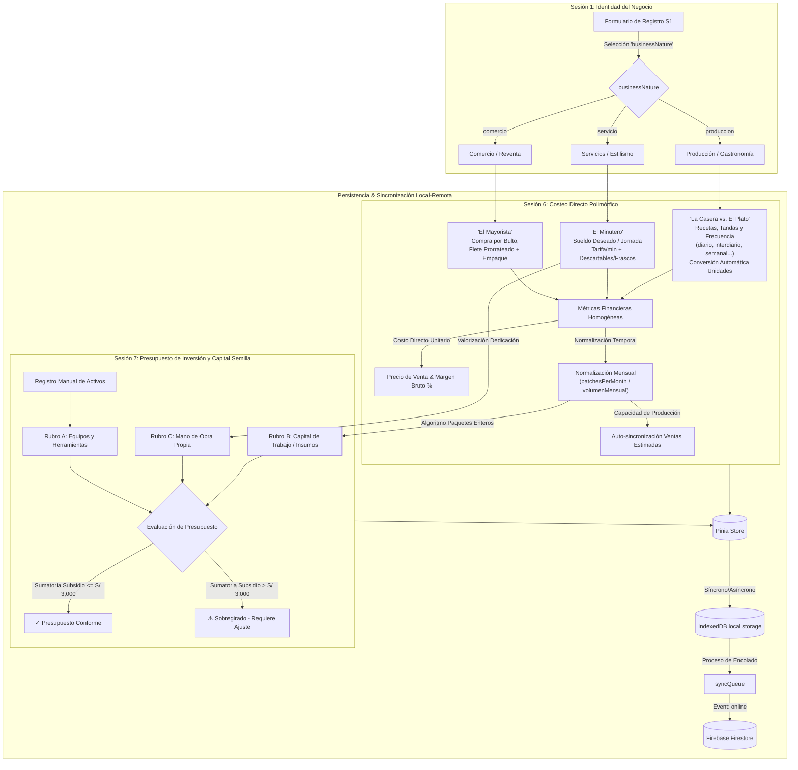
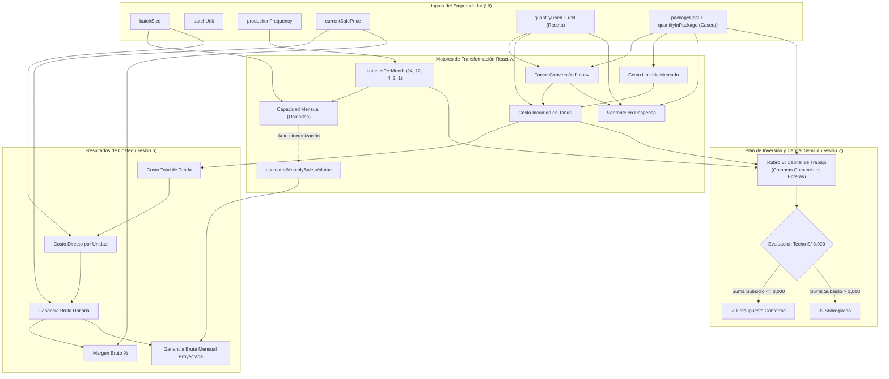

# ARQUITECTURA_COSTEO_E_INVERSION.md
# Manual Metodológico, Infraestructura de Datos, UX/UI y Arquitectura de Costeo (S6) e Inversión (S7)

---

## 1. Visión General y Propósito

Este documento establece la especificación técnica, metodológica, funcional y de diseño del **Módulo de Costeo Directo Polimórfico (Sesión 6)** y su interrelación integral con el **Plan de Inversión y Capital Semilla (Sesión 7)** en **EmprendeApp PWA**.

El sistema responde a una filosofía estricta **Offline-First**, diseñada para dispositivos móviles de gama baja y entornos con conectividad nula o intermitente. Transforma los modelos contables tradicionales (que causan fricción y deserción en microemprendedores) en **metodologías cotidianas populares** adaptadas a tres naturalezas de negocio:

1. **Producción / Gastronomía:** *"La Casera vs. El Plato"* (Lotes/tandas, consumo por receta, conversión automática de unidades, compras de mercado por volumen y sobrante en despensa).
2. **Servicios / Estilismo:** *"El Minutero"* (Tarifa por minuto de atención + suministros descartables y frascos rendidores).
3. **Comercio / Reventa:** *"El Mayorista"* (Compra por bulto/paquete, flete prorrateado y costo de empaque).

---

## 2. Diagrama de Arquitectura de Información e Interrelación S1 $\to$ S6 $\to$ S7



---

## 3. Conexión e Herencia Innata desde la Sesión 1

### 3.1. Selección y Reactividad de Naturaleza (`businessNature`)
*   En la Sesión 1 (S1), el participante define su tipo de negocio: `'produccion'`, `'servicio'` o `'comercio'`.
*   Al ingresar o crear productos en la Sesión 6 (S6), el sistema **PRECARGA por defecto** la modalidad seleccionada en S1 mediante la función `resolveDefaultNature()` en `src/stores/costing.js`.
*   **Prohibición de Mezcla:** No se permite mezclar modalidades entre productos de un mismo emprendimiento. La tarjeta de producto en `ProductBatchCard.vue` muestra un badge informativo de solo lectura sobre la modalidad innata del negocio.

### 3.2. Borrado Automático de Datos Previos ante Cambio de Modalidad
Si un participante modifica su `businessNature` en la Sesión 1, el store dispara la acción `applyBusinessNatureFromS1(newNature)`, la cual ejecuta `resetProductCostingData(prod, newNature)` sobre todos los productos:
*   Se vacían los arreglos de ingredientes de receta (`ingredients = []`).
*   Se resetea la configuración de servicio (`serviceConfig`) e insumos descartables/frascos.
*   Se vacía la configuración comercial (`commerceConfig`), fletes y empaques.
*   Se renombran los nombres por defecto a su marcador innato correspondiente (*"Nuevo Producto Elaborado"*, *"Nuevo Servicio"*, *"Nuevo Producto Comercial"*).

### 3.3. Títulos y Subtítulos Dinámicos
Los metadatos visuales de la Sesión 6 en `DashboardView.vue`, `SessionView.vue` y `GatekeeperLock.vue` consumen la configuración `SESSION_6_NATURE_CONFIG` en `src/data/sessionsData.js`:

| `businessNature` | Título Dinámico de Sesión 6 | Descripción Dinámica Adaptada |
| :--- | :--- | :--- |
| `produccion` | **Costeo Directo: "La Casera vs. El Plato"** | Insumos directos, compras por volumen y consumo por tanda. |
| `servicio` | **Costeo de Servicios: "El Minutero"** | Valor de tu tiempo por minuto, descartables y frascos rendidores. |
| `comercio` | **Costeo Comercial: "El Mayorista"** | Compra al por mayor en bultos, flete prorrateado y empaque. |

---

## 4. Metodología y Fórmulas Matemáticas de Costeo Polimórfico (Sesión 6)

Todas las operaciones matemáticas se implementan mediante funciones puras en `src/composables/useCostingCalculator.js` utilizando redondeo estricto a 2 o 3 decimales (`roundDecimals(val, decimals)`).

### 4.1. Modalidad Producción / Gastronomía ("La Casera vs. El Plato")

Calcula el costo por tanda o lote ($S_{\text{batch}}$) y lo divide entre el tamaño del lote para obtener el costo directo unitario. Resuelve la asimetría entre las unidades de cocina (receta) y las unidades de mercado (compra).

1. **Factor de Conversión Automática de Unidades ($f_{\text{conv}}$):**
   $$f_{\text{conv}} = \begin{cases} 
   0.001 & \text{si receta es 'gr' y compra es 'kg'} \\
   1000 & \text{si receta es 'kg' y compra es 'gr'} \\
   0.001 & \text{si receta es 'ml' y compra es 'L'} \\
   1000 & \text{si receta es 'L' y compra es 'ml'} \\
   1 & \text{en unidades equivalentes o directas}
   \end{cases}$$

2. **Cantidad Consumida en Unidades de Compra ($q_{\text{used, pkg}}$):**
   $$q_{\text{used, pkg}} = q_{\text{recipe}} \times f_{\text{conv}}$$

3. **Costo Unitario del Insumo en Mercado ($C_{\text{market}}$):**
   $$C_{\text{market}} = \frac{P_{\text{package}}}{Q_{\text{package}}}$$

4. **Costo Incurrido en la Tanda por Insumo ($C_{\text{batch, ing}}$):**
   $$C_{\text{batch, ing}} = q_{\text{used, pkg}} \times C_{\text{market}}$$

5. **Costo Directo Unitario por Plato/Unidad ($C_{\text{unit}}$):**
   $$C_{\text{unit}} = \frac{\sum_{i=1}^{n} C_{\text{batch, ing}, i}}{S_{\text{batch}}}$$

6. **Ganancia Bruta Unitaria y Margen Bruto %:**
   $$P_{\text{profit}} = P_{\text{sale}} - C_{\text{unit}}$$
   $$M_{\text{gross}} = \left(\frac{P_{\text{profit}}}{P_{\text{sale}}}\right) \times 100$$

7. **Sobrante en Despensa / Stock Remanente ($Q_{\text{leftover}}$):**
   $$R = q_{\text{used, pkg}} \pmod{Q_{\text{package}}}$$
   $$Q_{\text{leftover}} = \begin{cases} 0 & \text{si } R = 0 \\ \frac{Q_{\text{package}} - R}{f_{\text{conv}}} & \text{si } R > 0 \end{cases}$$

8. **Estimación de Ganancia Bruta Mensual:**
   $$\text{monthlyGrossProfit} = P_{\text{profit}} \times V_{\text{sales}}$$

---

### 4.2. Modalidad Servicios / Estilismo ("El Minutero")

Valoriza la dedicación temporal del emprendedor y suma el costo de los insumos por atención.

1. **Costo de Mano de Obra por Minuto (`calculateLaborCostPerMinute`):**
   $$M_{\text{month}} = D_{\text{days}} \times H_{\text{hours}} \times 60$$
   $$T_{\text{min}} = \frac{W_{\text{salary}}}{M_{\text{month}}}$$
   *Ejemplo:* Con S/ 1,200 deseado / (25 días $\times$ 8 horas $\times$ 60 min) = **S/ 0.100 / min**.

2. **Costo de Tiempo del Servicio:**
   $$C_{\text{time}} = \text{durationMinutes} \times T_{\text{min}}$$

3. **Costo Unitario de Suministros (Descartables vs. Frascos Rendidores):**
   *   *Descartable (`single_use`):*
       $$C_{\text{disc}} = \frac{P_{\text{package}}}{N_{\text{units}}}$$
   *   *Frasco Rendidor (`bottle_yield`):*
       $$C_{\text{bottle}} = \frac{P_{\text{package}}}{Y_{\text{clients}}}$$

4. **Costo Directo Total por Servicio:**
   $$C_{\text{service}} = C_{\text{time}} + \sum C_{\text{disc}} + \sum C_{\text{bottle}}$$

---

### 4.3. Modalidad Comercio / Reventa ("El Mayorista")

Prorratea los gastos de transporte/flete y empaque sobre el volumen de compra por bulto/docena.

1. **Costo Base de Mercadería:**
   $$C_{\text{base}} = \frac{P_{\text{package}}}{N_{\text{units}}}$$

2. **Flete Unitario Prorrateado:**
   $$C_{\text{freight}} = \frac{\text{Gasto total de flete/pasajes de compra}}{\text{Artículos totales traídos en el viaje}}$$

3. **Costo Directo Comercial Unitario:**
   $$C_{\text{commerce}} = C_{\text{base}} + C_{\text{freight}} + C_{\text{empaque}}$$

---

## 5. Arquitectura de Experiencia de Usuario (UX/UI) y Ergonomía Cognitiva

### 5.1. Principios Mobile-First para Microemprendimientos Populares
1. **Números Grandes sin Miedo:** Los datos financieros críticos (tamaño de lote, precio de venta, costo unitario) usan fuentes de gran tamaño (`text-2xl sm:text-3xl font-black`), facilitando la asimilación visual inmediata bajo luz solar directa o en pantallas con menor densidad de píxeles.
2. **Targets Táctiles $\ge 48\text{px}$:** Todos los botones, campos numéricos y selectores cumplen con los criterios de accesibilidad WCAG AAA para uso móvil táctil con una sola mano.
3. **Prevención de Zoom Forzado:** Tamaños de fuente mínimos de 16px (`text-base`) en campos de texto e inputs para evitar que los navegadores móviles (Safari/Chrome) hagan zoom invasivo al enfocar.
4. **Cero Alertas Bloqueantes:** Eliminación absoluta de `alert()` o pantallas de bloqueo. Se utilizan micro-estados reactivos, transiciones sutiles y badges informativos.

---

### 5.2. Componentes de UI y Patrones de Interacción

#### A. Tarjeta de Lote y Capacidad (`ProductBatchCard.vue`)
*   **Pestañas Horizontales:** Navegación por deslizamiento para gestionar hasta 5 productos o servicios con emojis identificadores (🍲, ✂️, 🏷️).
*   **Matriz Cuádruple de Operación:**
    1.  *¿Cuánto preparas por tanda?* (Input numérico + selector inline de unidad: *unidades*, *porciones*, *platos*, *paquetes*, *kilos*, *litros*).
    2.  *Precio de Venta* (Input con prefijo monetario `S/` en verde de alto contraste).
    3.  *Frecuencia de Preparación* (Selector descriptivo con equivalencia mensual: diaria = 24, interdiaria = 12, semanal = 4).
    4.  *Ventas Estimadas / Mes* (Input asistido con badge reactivo que indica la capacidad máxima calculada).
*   **Auto-Sincronización de Capacidad:** Si el campo de ventas estimadas está en 0 o vacío, se sincroniza automáticamente con la capacidad máxima mensual:
    $$\text{monthlyUnitsCapacity} = S_{\text{batch}} \times \text{batchesPerMonth}$$

#### B. Selector Contextual Inteligente de Empaques (`AddIngredientSheet.vue`)
Al seleccionar la unidad de la receta, el modal configura dinámicamente las opciones comerciales más comunes (`PACKAGE_PRESETS`) del mercado popular:

```
[Unidad Receta: Gramos (gr)]
  ├──> Bolsa / Paquete (1 kg = 1,000 gr)  [Factor 0.001 automático]
  ├──> Bolsita chica (250 gr)
  ├──> Paquete mediano (500 gr)
  ├──> Saco comercial (25 kg)
  └──> Otro peso personalizado...
```

#### C. Badges Semánticos de 2 Niveles (`IngredientRow.vue`)
Cada insumo registrado se presenta desglosado visualmente en dos planos pedagógicos:
*   **Badge Ámbar (El Plato / La Receta):** Consumo en la tanda y consumo unitario (`0.20 kg / plato`), reactivo a la unidad de tanda.
*   **Badge Azul (La Casera / El Mercado):** Nombre del empaque comercial y precio de compra (`saco de 25 kg a S/ 85.00`).
*   **Píldora Verde (El Costo Unitario):** Costo por unidad con botón interactivo `ℹ️`.

#### D. Divulgación Progresiva con Botón `ℹ️`
Dentro de la píldora verde de costo unitario, el botón `ℹ️` expande suavemente (`animate-fadeIn`) un desglose inline sin abrir ventanas modales invasivas:

$$\begin{aligned}
\text{Costo total en la tanda:} & \quad \mathbf{S/\ 45.00} \\
\text{Preparación de la tanda:} & \quad \mathbf{\div\ 10\ \text{platos}} \\
\hline
\text{Costo por plato:} & \quad \mathbf{=\ S/\ 4.50}
\end{aligned}$$

> 💡 **Comprobación didáctica:** $10\text{ platos} \times \text{S/ } 4.50 = \text{S/ } 45.00$ de este insumo en cada preparación.

#### E. Normalización y Singularización Dinámica de Unidades
Las funciones computadas `cleanSingleBatchUnit` y `cleanBatchUnitPlural` en [`IngredientRow.vue`](file:///c:/Users/User/Proyectos/plan-seed/src/components/costing/IngredientRow.vue) transforman reactivamente la unidad seleccionada en la tanda:
*   Si la tanda es *"porciones"*, el badge muestra `0.20 kg / porción` y el header `Por porción`.
*   Si la tanda es *"unidades"*, muestra `0.20 kg / unidad` y el header `Por unidad`.
*   Si la tanda es *"platos"*, muestra `0.20 kg / plato` y el header `Por plato`.

---

## 6. Diccionario de Variables y Sistema Relacional

### 6.1. Mapeo Exhaustivo de Variables

| Variable | Tipo | Capa / Componente | Rol en el Sistema |
| :--- | :--- | :--- | :--- |
| `batchSize` | `Number` | Input (`ProductBatchCard`) | Cantidad producida en una sola tanda ($S_{\text{batch}}$) |
| `batchUnit` | `String` | Input (`ProductBatchCard`) | Unidad de medida de la tanda (*unidades*, *porciones*, etc.) |
| `productionFrequency` | `String` | Input (`ProductBatchCard`) | Frecuencia de preparación (*diario*, *interdiario*, *semanal*, etc.) |
| `currentSalePrice` | `Number` | Input (`ProductBatchCard`) | Precio de venta unitario al público ($P_{\text{sale}}$) |
| `estimatedMonthlySalesVolume` | `Number` | Input (`ProductBatchCard`) | Proyección mensual de ventas en unidades ($V_{\text{sales}}$) |
| `quantityUsed` | `Number` | Input (`AddIngredientSheet`) | Cantidad del insumo consumida en la tanda ($q_{\text{recipe}}$) |
| `unit` | `String` | Input (`AddIngredientSheet`) | Unidad de medida de la receta (`gr`, `kg`, `ml`, `L`, `unidades`) |
| `packageUnitName` | `String` | Input (`AddIngredientSheet`) | Nombre del empaque comercial (ej. *saco 25kg*, *plancha 30*) |
| `quantityInPackage` | `Number` | Input (`AddIngredientSheet`) | Contenido numérico del paquete comercial ($Q_{\text{package}}$) |
| `packageCost` | `Number` | Input (`AddIngredientSheet`) | Precio total pagado por el paquete ($P_{\text{package}}$) |
| `batchesPerMonth` | `Number` | Computada (`useCostingCalculator`) | Cantidad de tandas mensuales normalizadas (24, 12, 4, 2, 1) |
| `monthlyUnitsCapacity` | `Number` | Computada (`ProductBatchCard`) | Capacidad máxima mensual: $S_{\text{batch}} \times \text{batchesPerMonth}$ |
| `conversionFactor` | `Number` | Computada (`useCostingCalculator`) | Factor $f_{\text{conv}}$ entre receta y compra |
| `unitCostFromMarket` | `Number` | Computada (`useCostingCalculator`) | Costo de una unidad base en el mercado: $\frac{P_{\text{package}}}{Q_{\text{package}}}$ |
| `costIncurredInBatch` | `Number` | Computada (`useCostingCalculator`) | Costo consumido en la tanda: $(q_{\text{recipe}} \times f_{\text{conv}}) \times C_{\text{market}}$ |
| `leftoverQuantityInStock`| `Number` | Computada (`useCostingCalculator`) | Cantidad de insumo que queda disponible en despensa |
| `directCostPerUnit` | `Number` | Computada (`useCostingCalculator`) | Costo directo asignable a cada unidad: $\frac{\sum C_{\text{batch}}}{S_{\text{batch}}}$ |
| `grossProfitPerUnit` | `Number` | Computada (`useCostingCalculator`) | Ganancia bruta unitaria: $P_{\text{sale}} - C_{\text{unit}}$ |
| `grossMarginPercentage`| `Number` | Computada (`useCostingCalculator`) | Margen sobre ventas: $\left(\frac{P_{\text{profit}}}{P_{\text{sale}}}\right) \times 100$ |

---

### 6.2. Diagrama Relacional de Flujo de Variables



---

## 7. Normalización Temporal y Traductores S6 $\to$ S7

### 7.1. Tabla de Normalización de Frecuencias
Para resolver la asincronía entre tandas de producción y el presupuesto mensual de Sesión 7, se establece la constante `FREQUENCY_BATCHES_PER_MONTH`:

$$\text{batchesPerMonth} = \begin{cases} 
24 & \text{si frecuencia es 'diario'} \\
12 & \text{si frecuencia es 'interdiario'} \\
4 & \text{si frecuencia es 'semanal'} \\
2 & \text{si frecuencia es 'quincenal'} \\
1 & \text{si frecuencia es 'mensual'} 
\end{cases}$$

---

### 7.2. Algoritmo "La Casera vs. El Plato" para Capital de Trabajo
El composable `getMonthlyWorkingCapitalRequirements` convierte las recetas de Sesión 6 en requerimientos de compras comerciales enteras para 1 mes de abastecimiento:

1. **Consumo Mensual Proyectado en Recetas:**
   $$\text{monthlyQuantityConsumed} = q_{\text{recipe}} \times \text{batchesPerMonth}$$

2. **Cálculo de Paquetes Comerciales Enteros a Comprar (Función Techo):**
   $$\text{packagesToBuy} = \left\lceil \frac{\text{monthlyQuantityConsumed} \times f_{\text{conv}}}{Q_{\text{package}}} \right\rceil$$

3. **Presupuesto Requerido por Insumo:**
   $$\text{requiredBudget} = \text{packagesToBuy} \times P_{\text{package}}$$

---

## 8. Arquitectura del Plan de Inversión y Capital Semilla (Sesión 7)

### 8.1. Estandarización en 3 Rubros Oficiales

El presupuesto de inversión consolidado agrupa los ítems en tres rubros normalizados:

| Rubro | Denominación Oficial | Componente UI | Origen de Datos | Regla de Financiamiento |
| :--- | :--- | :--- | :--- | :--- |
| **Rubro A** | **Maquinaria, Herramientas y Equipos** | `InvestmentItemRow.vue` | Formulario manual (+ Agregar Equipo) | Conmutable (Subsidio o Aporte Propio) |
| **Rubro B** | **Capital de Trabajo / Insumos Iniciales** | `WorkingCapitalSection.vue` | Sincronizado automáticamente desde recetas de S6 | Conmutable individualmente con interruptor $\ge 48\text{px}$ |
| **Rubro C** | **Acondicionamiento y Mano de Obra Propia** | `InvestmentItemRow.vue` | Dedicación del emprendedor en S6 + mejoras manuales | **Mano de obra fijada como Aporte Propio obligatorio (S/ 0 Subsidio)** |

---

### 8.2. Protección y Fijación de Mano de Obra Propia (Rubro C)
La dedicación del emprendedor (calculada vía `calculateProjectedMonthlyLaborValue`) se inyecta como ítem de contrapartida:
*   `isLaborContribution: true`
*   `financedBySeedCapital: false`
*   `source: 'propio'`
*   En `InvestmentItemRow.vue`, los campos de cantidad y precio están bloqueados en modo lectura y el interruptor de subsidio exhibe una tarjeta estática de contrapartida, impidiendo que el emprendedor consuma los S/ 3,000.00 del fondo no reembolsable en su propio sueldo.

---

### 8.3. Preservación de Decisiones del Usuario en Sincronizaciones Recurrentes
La acción `syncWorkingCapitalToInvestmentPlan()` en `src/stores/costing.js`:
1. Mantiene los ítems manuales ingresados en Rubro A y Rubro C.
2. Lee los requerimientos calculados por `getMonthlyWorkingCapitalRequirements`.
3. Mapea las decisiones previas de financiamiento (`prevAutoFinancingMap.get(req.itemId)`).
4. Si el usuario marcó manualmente que pagaría un saco/insumo con **Aporte Propio**, la decisión se conserva aunque se recalculen las recetas o precios en la Sesión 6.

---

### 8.4. Fórmulas de Evaluación Presupuestal y Techo Presupuestal
La función `computeSeedCapitalPlan` en `useCostingCalculator.js` realiza el cálculo del presupuesto:

1. **Capital Semilla Asignado al Subsidio:**
   $$\text{allocatedSeedCapital} = \sum_{i \in \text{Financiados}} \text{totalPrice}_i$$

2. **Aporte Propio del Emprendedor (Contrapartida):**
   $$\text{ownContribution} = \sum_{i \in \text{Propios}} \text{totalPrice}_i$$

3. **Inversión Total del Negocio:**
   $$\text{totalBusinessInvestment} = \text{allocatedSeedCapital} + \text{ownContribution}$$

4. **Saldo Restante y Evaluación de Cumplimiento:**
   $$\text{remainingBudget} = \text{seedCapitalCeiling} - \text{allocatedSeedCapital}$$
   $$\text{isBudgetCompliant} = (\text{allocatedSeedCapital} \le \text{seedCapitalCeiling})$$

---

## 9. Infraestructura de Datos y Esquema JSON

### 9.1. Extensión de `products` (Sesión 6)
```json
{
  "productId": "PROD-PANADERIA",
  "productName": "Pan Integral Artesanal",
  "businessNature": "produccion",
  "batchConfig": {
    "batchSize": 50,
    "batchUnit": "unidades",
    "productionFrequency": "interdiario",
    "batchesPerMonth": 12
  },
  "commercialization": {
    "currentSalePrice": 1.50,
    "estimatedMonthlySalesVolume": 600
  },
  "ingredients": [
    {
      "ingredientId": "ING-HARINA",
      "name": "Harina de Trigo Integral",
      "recipeConsumption": {
        "quantityUsed": 5000,
        "unit": "gr"
      },
      "marketPurchase": {
        "packageUnitName": "saco 25kg",
        "quantityInPackage": 25,
        "packageUnit": "kg",
        "packageCost": 85.0
      },
      "automatedMath": {
        "unitCostFromMarket": 3.40,
        "costIncurredInBatch": 17.00,
        "unitCostPerProduct": 0.34,
        "leftoverQuantityInStock": 20000,
        "conversionFactor": 0.001
      }
    }
  ]
}
```

### 9.2. Extensión de `investmentItems` (Sesión 7)
```json
{
  "itemId": "WORKING-CAP-PROD-PANADERIA-ING-HARINA",
  "rubro": "rubro_b",
  "category": "Insumos y Capital de Trabajo",
  "description": "Harina de Trigo Integral (3 saco 25kg para 12 tandas/mes)",
  "quantity": 3,
  "unit": "saco 25kg",
  "unitPriceEstimated": 85.0,
  "totalPrice": 255.0,
  "financedBySeedCapital": true,
  "source": "capital_semilla",
  "isAutoDerivedFromS6": true,
  "isLaborContribution": false
}
```

---

## 10. Mapeo de Componentes, Composables y Stores

| Archivo | Ruta | Responsabilidad Principal |
| :--- | :--- | :--- |
| `useCostingCalculator.js` | `src/composables/` | Composables puros con matemáticas de costeo polimórfico, conversión de unidades ($f_{\text{conv}}$), normalización de frecuencias, cálculo de paquetes enteros y evaluación de los 3 rubros. |
| `costing.js` | `src/stores/` | Pinia store de costeo e inversión. Hidratación/persistencia en IndexedDB, acciones reactivas de S1 a S6 y sincronización S6 $\to$ S7 conservando decisiones del usuario. |
| `ProductBatchCard.vue` | `src/components/costing/` | Renderizado de tarjeta de producto en S6 con badge innato por naturaleza, auto-sincronización de capacidad con ventas estimadas y números grandes. |
| `AddIngredientSheet.vue` | `src/components/costing/` | Modal de registro de insumos con selector contextual inteligente de empaques (`PACKAGE_PRESETS`) y conversión automática de gramos a kilos o ml a litros. |
| `IngredientRow.vue` | `src/components/costing/` | Fila individual de insumo en S6 con badges semánticos de 2 niveles (Ámbar vs Azul), badges reactivos a la unidad de tanda y botón interactivo `ℹ️` para desglose matemático inline. |
| `ServiceCostingSection.vue` | `src/components/costing/` | Vista de costeo de servicios con banner de meta salarial, modal de ajuste en vivo y costo por minuto bloqueado. |
| `CommerceCostingSection.vue` | `src/components/costing/` | Vista de costeo comercial con flete y empaque prorrateado por bulto. |
| `WorkingCapitalSection.vue` | `src/components/costing/` | Componente de Rubro B en S7. Renderiza insumos derivados de S6 con interruptores táctiles $\ge 48\text{px}$ y estado vacío pedagógico. |
| `SeedCapitalBar.vue` | `src/components/costing/` | Barra gráfica de presupuesto con desglose en mini-tarjetas para los 3 Rubros (A, B, C) y control de sobregiro. |
| `InvestmentItemRow.vue` | `src/components/costing/` | Fila individual de inversión con badges de rubro y bloqueo de mano de obra propia. |
| `SessionView.vue` | `src/views/` | Vista principal de sesiones. Pasa props reactivos de unidad de tanda (`:batch-unit`) a filas de insumos y maneja la sincronización automática al ingresar a S7. |

---

## 11. Guía Pedagógica y Casos Prácticos Resueltos

### 11.1. Protocolo de Entrevista de Campo para Facilitadores
El facilitador debe evitar el lenguaje contable formal sustituyéndolo por preguntas pedagógicas cotidianas:

| Concepto Técnico | Pregunta Pedagógica Cotidiana Sugerida |
| :--- | :--- |
| **Tamaño de Lote ($S_{\text{batch}}$)** | *"Cuando te pones a cocinar o producir de un solo golpe, ¿cuántos platos o unidades sacas listos?"* |
| **Costo Variable Unitario** | *"Vamos a ver cuánto le entra a esa olla o molde. ¿Qué insumos le echas y en qué cantidad?"* |
| **Presentación Mayorista** | *"Con la casera en el mercado, ¿cómo compras este insumo: por kilo suelto, por saco o por docena?"* |
| **Capacidad Instalada** | *"Si preparas esta tanda tantas veces a la semana, ¿cuánto es lo máximo que podrías vender en un mes bueno?"* |

---

### 11.2. Casos de Estudio Completos y Resueltos

#### Caso A: Producción Gastronómica — Pastelería Artesanal
*   **Producto:** Torta de Chocolate Artesanal (`batchSize: 12`, `batchUnit: 'porciones'`).
*   **Frecuencia:** **Semanal** (4 tandas/mes = 48 porciones/mes de capacidad).
*   **Precio de Venta:** **S/ 8.00** por porción.

| Insumo | Consumo Receta | Compra Casera | Conversión | Costo en Tanda | Costo por Porción | Sobrante |
| :--- | :--- | :--- | :--- | :--- | :--- | :--- |
| **Harina sin preparar** | 600 gr | Bolsa de 1 kg a S/ 4.50 | $600 \times 0.001 = 0.60\text{ kg}$ | S/ 2.70 | S/ 0.225 | 400 gr |
| **Cacao en polvo** | 200 gr | Bolsita de 250 gr a S/ 7.50 | $\frac{7.50}{250} = \text{S/ } 0.030/\text{gr}$ | S/ 6.00 | S/ 0.500 | 50 gr |
| **Huevos frescos** | 6 unidades | Plancha de 30 a S/ 18.00 | $\frac{18.00}{30} = \text{S/ } 0.60/\text{u}$ | S/ 3.60 | S/ 0.300 | 24 unidades |
| **Totales** | — | — | — | **S/ 12.30** | **S/ 1.025** | — |

*   **Ganancia Bruta por Porción:** $\text{S/ } 8.00 - 1.025 = \mathbf{S/\ 6.975}$
*   **Margen Bruto:** $\mathbf{87.19\%}$
*   **Ganancia Bruta Mensual (48 porciones):** $48 \times 6.975 = \mathbf{S/\ 334.80}$

#### Caso B: Servicios Personales — Barbería y Estilismo
*   **Servicio:** Corte de Cabello Clásico y Acabado con Navaja (30 minutos).
*   **Precio Cobrado:** **S/ 20.00**.
*   **Meta Salarial:** S/ 1,500 mensual trabajando 25 días, 8 horas diarias ($12,000\text{ min/mes} \implies \mathbf{S/\ 0.125/\text{min}}$).
*   **Costos Directos:** Mano de obra (S/ 3.75) + navaja descartable (S/ 0.20) + cuellero (S/ 0.10) + gel de afeitar (S/ 0.60) + aftershave (S/ 0.30) = **S/ 4.95**.
*   **Ganancia Bruta por Corte:** $\text{S/ } 20.00 - 4.95 = \mathbf{S/\ 15.05}$ (**Margen: 75.25%**).

#### Caso C: Comercio y Reventa — Boutique de Ropa
*   **Producto:** Polo Oversize de Algodón Reactivo.
*   **Compra Mayorista:** Docena (12 unidades) a S/ 180.00 ($\implies \text{S/ } 15.00/\text{polo}$).
*   **Flete de Compra:** Taxi/tren de S/ 24.00 para 48 polos ($\implies \text{S/ } 0.50/\text{polo}$).
*   **Empaque:** Bolsa ecológica personalizada ($\implies \text{S/ } 0.40/\text{polo}$).
*   **Costo Directo Total:** $\text{S/ } 15.00 + 0.50 + 0.40 = \mathbf{S/\ 15.90}$.
*   **Precio de Venta:** **S/ 35.00** $\implies$ **Ganancia Bruta:** $\mathbf{S/\ 19.10}$ (**Margen: 54.57%**).

---

## 12. Verificación de Calidad y Pruebas

La arquitectura y sus motores matemáticos se encuentran validados mediante pruebas automatizadas y compilación de producción PWA:

1. **Pruebas Matemáticas Unitarias (`test/costing_math.test.mjs`):**
   - **10/10 bloques de prueba pasados exitosamente** (comercio, servicios, producción, tarifa por minuto, títulos dinámicos, normalización de frecuencias, compra en paquetes enteros, valorización salarial, cumplimiento de techo presupuestal y **conversión automática de unidades de medida**).
2. **Pruebas de Integración y Borrado Automático (`test/costing_integration.test.mjs`):**
   - **8/8 bloques pasados exitosamente** (borrado automático al cambiar `businessNature`, normalización de métricas y sincronización S6 $\leftrightarrow$ S7 conservando los interruptores manuales del usuario).
3. **Compilación PWA de Producción (`npm run build`):**
   - Compilación en Vite limpia en **8.27s** con precache de Workbox activo y Service Worker generado sin advertencias críticas.
