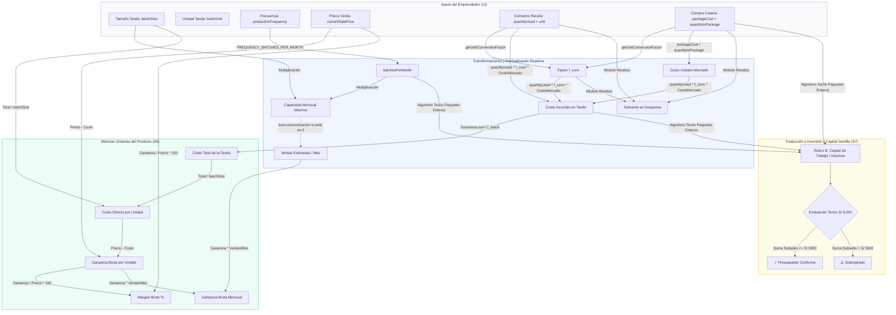

# INFORME TÉCNICO Y METODOLÓGICO: MÓDULO DE COSTEO POLIMÓRFICO
## Metodología Popular, Arquitectura de Datos, Experiencia de Usuario (UX/UI) y Guía Pedagógica

---

## 1. Ficha Técnica y Resumen Ejecutivo

| Parámetro | Detalle |
| :--- | :--- |
| **Módulo** | Sesión 6: Costeo Directo Polimórfico (*"La Casera vs. El Plato"*, *"El Minutero"*, *"El Mayorista"*) |
| **Aplicación** | EmprendeApp PWA (Offline-First) |
| **Público Objetivo** | Microemprendedores populares, participantes de programas de capital semilla y facilitadores de campo |
| **Stack Técnico** | Vue 3.4+ (`<script setup>`, Composition API), Pinia, IndexedDB (`idb-keyval`), Tailwind CSS Mobile-First |
| **Dispositivos Objetivo** | Smartphones de gama baja y media (resoluciones base de 360px a 420px de ancho) |
| **Conectividad** | 100% operativo sin internet con sincronización reactiva local y encolado en `syncQueue` |

### Propósito del Documento
Este informe técnico y metodológico desglosa integralmente el diseño, la lógica matemática, la arquitectura de variables y los patrones de experiencia de usuario (UX/UI) desarrollados para el **Módulo de Costeo**. Explica cómo se tradujo la teoría económica y contable formal a una experiencia intuitiva, accesible y pedagógicamente empoderadora, eliminando la sobrecarga cognitiva que históricamente ha generado el abandono de herramientas de gestión en la base de la pirámide económica.

---

## 2. Marco Metodológico: Del Costeo Contable Formal al Costeo Popular Polimórfico

### 2.1. El Conflicto Cognitivo del Costeo Tradicional
La enseñanza contable estándar impone tablas de doble entrada, prorrateos de costos indirectos de fabricación (CIF), fórmulas de depreciación lineal y estados de resultados estructurados. Para un microemprendedor popular (un cocinero, una costurera, un barbero o una comerciante de mercado), estas herramientas representan una **barrera cognitiva insalvable**:
1. **Asimetría de escala:** Los insumos se compran en presentaciones comerciales mayoristas (*sacos de 25 kg*, *cajas de 24 latas*, *galones de 3.785 L*), pero se consumen en micro-porciones cotidianas (*250 gr*, *2 cucharadas*, *media taza*).
2. **Ignorancia del costo por lote:** El productor calcula empíricamente *"para cuánto le rinde una preparación o tanda"*, no cuánto cuesta una unidad abstracta aislada.
3. **Invisibilización de la mano de obra propia:** El autoempleado suele omitir su propio trabajo, considerando erróneamente que "la ganancia es todo lo que queda en el bolsillo al final del día".
4. **Fletes y pérdidas no cuantificadas:** Los viajes de abastecimiento y las bolsas de empaque se pagan del bolsillo personal sin sumarse al costo real del producto.

### 2.2. Polimorfismo Metodológico según la Naturaleza del Negocio (`businessNature`)
EmprendeApp resuelve este dilema mediante **3 metodologías diferenciadas** adaptadas a la realidad operativa del negocio, fijadas de manera innata desde la Sesión 1:

```
                               ┌───> [PRODUCCIÓN / GASTRONOMÍA] ───> "La Casera vs. El Plato"
                               │     (Recetas por tanda, empaques mayoristas y sobrante)
[Sesión 1: Identidad Negocio] ─┼───> [SERVICIOS / ESTILISMO]     ───> "El Minutero"
(businessNature)               │     (Valor del tiempo por minuto + descartables/frascos)
                               └───> [COMERCIO / REVENTA]        ───> "El Mayorista"
                                     (Bultos mayoristas, flete prorrateado y presentación)
```

---

### 2.3. Metodología 1: "La Casera vs. El Plato" (Producción y Gastronomía)
Esta metodología modela la dinámica real de preparación en lotes o tandas:
*   **La Tanda (El Lote de Producción):** Es la unidad mental natural del artesano o cocinero. No se cocina 1 porción de seco de pollo; se cocina una olla para 15 porciones. No se hornea 1 queque; se hornea un molde para 12 rebanadas.
*   **La Casera (La Compra Comercial):** En el mercado no te venden 200 gramos de harina a granel al mismo costo del saco; compras una bolsa de 1 kg o un saco de 25 kg a un precio comercial paquete.
*   **El Plato (El Consumo de Receta):** Lo que entra físicamente a la preparación.
*   **El Sobrante en Despensa (Stock Remanente):** La diferencia que no se usó en la tanda pero que ya se pagó y queda disponible en la despensa para preparaciones futuras, constituyendo capital de trabajo inmovilizado.

#### Fórmulas de Producción:
1. **Factor de Conversión Automática ($f_{\text{conv}}$):**
   $$f_{\text{conv}} = \begin{cases} 
   0.001 & \text{si receta es 'gr' y compra es 'kg'} \\
   1000 & \text{si receta es 'kg' y compra es 'gr'} \\
   0.001 & \text{si receta es 'ml' y compra es 'L'} \\
   1000 & \text{si receta es 'L' y compra es 'ml'} \\
   1 & \text{en unidades equivalentes}
   \end{cases}$$

2. **Cantidad Usada Homogeneizada ($q_{\text{used, pkg}}$):**
   $$q_{\text{used, pkg}} = q_{\text{recipe}} \times f_{\text{conv}}$$

3. **Costo Unitario en Mercado ($C_{\text{market}}$):**
   $$C_{\text{market}} = \frac{P_{\text{package}}}{Q_{\text{package}}}$$

4. **Costo Incurrido en la Tanda ($C_{\text{batch, ing}}$):**
   $$C_{\text{batch, ing}} = q_{\text{used, pkg}} \times C_{\text{market}}$$

5. **Costo Directo Unitario por Plato/Unidad ($C_{\text{unit}}$):**
   $$C_{\text{unit}} = \frac{\sum_{i=1}^{n} C_{\text{batch, ing}, i}}{S_{\text{batch}}}$$
   *(donde $S_{\text{batch}}$ es el tamaño de la tanda).*

6. **Sobrante en Despensa ($Q_{\text{leftover}}$):**
   $$R = q_{\text{used, pkg}} \pmod{Q_{\text{package}}}$$
   $$Q_{\text{leftover}} = \begin{cases} 0 & \text{si } R = 0 \\ \frac{Q_{\text{package}} - R}{f_{\text{conv}}} & \text{si } R > 0 \end{cases}$$

---

### 2.4. Metodología 2: "El Minutero" (Servicios y Estilismo)
Para servicios personales (peluquerías, manicura, sastrería, reparaciones), el recurso más escaso y valioso es el tiempo del profesional.

#### Fórmulas de Servicios:
1. **Capacidad Temporal Mensual en Minutos ($M_{\text{month}}$):**
   $$M_{\text{month}} = D_{\text{days}} \times H_{\text{hours}} \times 60$$

2. **Costo de Mano de Obra por Minuto ($T_{\text{min}}$):**
   $$T_{\text{min}} = \frac{W_{\text{salary}}}{M_{\text{month}}}$$
   *Ejemplo pedagógico:* Si el barbero desea ganar S/ 1,200 al mes trabajando 25 días, 8 horas diarias:
   $$M_{\text{month}} = 25 \times 8 \times 60 = 12,000 \text{ minutos/mes}$$
   $$T_{\text{min}} = \frac{1,200}{12,000} = \text{S/ } 0.100 \text{ por minuto}$$

3. **Costo del Tiempo del Servicio ($C_{\text{time}}$):**
   $$C_{\text{time}} = \text{Duración (min)} \times T_{\text{min}}$$

4. **Costo de Insumos según su Naturaleza:**
   *   **Descartable de 1 solo uso ($C_{\text{disc}}$):** $C_{\text{disc}} = \frac{P_{\text{paquete}}}{N_{\text{piezas}}}$ (ej. un par de guantes de látex de una caja de 100).
   *   **Frasco Rendidor ($C_{\text{bottle}}$):** $C_{\text{bottle}} = \frac{P_{\text{frasco}}}{\text{Clientes que rinde}}$ (ej. un pomo de tinte o crema que rinde para 8 atenciones).

5. **Costo Directo por Servicio ($C_{\text{service}}$):**
   $$C_{\text{service}} = C_{\text{time}} + \sum C_{\text{disc}} + \sum C_{\text{bottle}}$$

---

### 2.5. Metodología 3: "El Mayorista" (Comercio y Reventa)
Para microtiendas y puestos de ropa, el valor no se agrega en la transformación de materias primas sino en la selección y comercialización. El error común es fijar precios únicamente con el valor de factura, olvidando el flete y la bolsa.

#### Fórmulas de Comercio:
1. **Costo Base de Mercadería ($C_{\text{base}}$):**
   $$C_{\text{base}} = \frac{P_{\text{bulto}}}{N_{\text{unidades}}}$$

2. **Flete Prorrateado por Unidad ($C_{\text{freight}}$):**
   $$C_{\text{freight}} = \frac{\text{Gasto total de pasajes/taxi de compra}}{\text{Prendas/artículos totales traídos en el viaje}}$$

3. **Costo Directo Comercial ($C_{\text{commerce}}$):**
   $$C_{\text{commerce}} = C_{\text{base}} + C_{\text{freight}} + C_{\text{empaque}}$$

---

## 3. Experiencia de Usuario (UX) e Interfaz (UI): Psicología y Diseño

### 3.1. Principios Rectores de UX Popular Mobile-First
El diseño de la interfaz responde a cinco directrices ergonómicas y psicológicas:

1. **Números Grandes sin Miedo:** Los datos financieros críticos (tamaño de tanda, precio de venta, costo unitario) no se ocultan en tablas densas. Se muestran con tipografía robusta (`text-2xl sm:text-3xl font-black`), permitiendo que el usuario asimile su valor de un solo vistazo, incluso en pantallas pequeñas o bajo luz solar directa.
2. **Targets Táctiles $\ge 48\text{px}$:** Todos los botones, campos numéricos y selectores cumplen con el estándar WCAG AAA para uso móvil táctil con una sola mano.
3. **Prevención del Zoom Forzado en Safari/Chrome Móvil:** Los inputs utilizan tamaño de fuente mínimo de 16px (`text-base`), evitando que los navegadores móviles hagan zoom inoportuno al enfocar campos de texto.
4. **Cero Pantallas Blancas o Alertas Invasivas:** Prohibido el uso de `alert()`, `confirm()` nativos intrusivos o loaders a pantalla completa. Toda interacción utiliza toasts discretos, skeletons y badges reactivos.

---

### 3.2. Anatomía de los Componentes Clave

#### A. Tarjeta de Lote y Capacidad (`ProductBatchCard.vue`)
*   **Pestañas Superiores de Productos (Máx. 5):** Permite cambiar entre hasta 5 productos o servicios mediante pills horizontales deslizables con scroll suave.
*   **Badge Innato de Naturaleza:** Muestra en la parte superior el icono y título de la modalidad establecida en Sesión 1 (🍲 Producción, ✂️ Servicio, 🏷️ Comercio), protegiendo al usuario de confusiones conceptuales.
*   **Matriz Cuádruple de Datos Operativos:**
    1.  *¿Cuánto preparas por tanda?* (Input numérico + selector inline de unidad: *unidades*, *porciones*, *platos*, *paquetes*, *kilos*, *litros*).
    2.  *Precio de Venta* (Input con prefijo monetario `S/` en verde de alto contraste).
    3.  *Frecuencia de Preparación* (Selector descriptivo con equivalencia mensual: *Diaria = 24 tandas/mes*, *Interdiaria = 12 tandas/mes*, *Semanal = 4 tandas/mes*).
    4.  *Ventas Estimadas / Mes* (Campo numérico asistido con badge reactivo de capacidad máxima calculada).

#### B. Selector Contextual Inteligente de Empaques (`AddIngredientSheet.vue`)
Elimina la necesidad de que el microemprendedor recuerde conversiones matemáticas. Al elegir la unidad de la receta, el selector de compra se reconfigura dinámicamente con opciones del comercio popular peruano/latinoamericano:

| Unidad Receta | Presets de Compra Comercial Desplegados | Equivalencia Interna |
| :--- | :--- | :--- |
| **Gramos (gr)** | • Bolsa / Paquete (1 kg = 1,000 gr)<br>• Bolsita chica (250 gr)<br>• Paquete mediano (500 gr)<br>• Saco comercial (25 kg) | Transforma gramos a fracción de kilo ($0.001$) sin que el usuario haga divisiones |
| **Kilos (kg)** | • Bolsa / Kilo suelto (1 kg)<br>• Bolsa mediana (5 kg)<br>• Saco comercial (25 kg)<br>• Saco mayorista (50 kg) | Unidades directas en kg |
| **Mililitros (ml)**| • Botella estándar (1 L = 1,000 ml)<br>• Frasco / Botellita (250 ml)<br>• Galón comercial (3.785 L = 3,785 ml) | Factor automático $0.001$ |
| **Litros (L)** | • Botella estándar (1 L)<br>• Botella familiar (3 L)<br>• Galón comercial (3.785 L)<br>• Bidón / Balde (20 L) | Volumen directo en litros |
| **Unidades (u.)**| • Unidad suelta (1 u.)<br>• Docena (12 u.)<br>• Plancha de huevos (30 u.)<br>• Caja comercial (24 u.)<br>• Ciento (100 u.) | Agrupaciones comerciales estándar |

#### C. Fila de Insumo con Badges Semánticos de 2 Niveles (`IngredientRow.vue`)
Cada insumo registrado se presenta desglosado visualmente en dos planos:
```
┌────────────────────────────────────────────────────────────────────────┐
│ [1] Pollo Fresco Entero                          [POR PLATO: S/ 4.50 ℹ️] │
├────────────────────────────────────────────────────────────────────────┤
│  [🍽️ RECETA: 2 kg en tanda]    [0.20 kg / plato]                       │
│  [🛒 COMPRA: pollo entero (2 kg) a S/ 18.00]                           │
├────────────────────────────────────────────────────────────────────────┤
│  📦 Sobrante: 0 (justo)                              [✏️ Editar] [🗑️]   │
└────────────────────────────────────────────────────────────────────────┘
```
*   **Nivel Ámbar (El Plato / La Receta):** Cantidad consumida en la tanda y rendimiento individual por porción/plato.
*   **Nivel Azul (La Casera / El Mercado):** Presentación del paquete comercial adquirido y precio de compra.
*   **Píldora Verde (El Costo Unitario):** Costo directo absorbido por cada plato, con botón orgánico `ℹ️`.

---

### 3.3. Divulgación Progresiva (Progressive Disclosure) con el Botón `ℹ️`
Uno de los descubrimientos de usabilidad más importantes fue que los microemprendedores se sentían inseguros de cómo una bolsa de S/ 18.00 se transformaba en S/ 4.50 por plato.

En lugar de abrir un modal bloqueante invasivo que saca al usuario del contexto, el botón `ℹ️` situado dentro de la píldora verde expande suavemente (`animate-fadeIn`) una tarjeta pedagógica inline:

$$\begin{aligned}
\text{Costo total en la tanda:} & \quad \mathbf{S/\ 45.00} \\
\text{Preparación de la tanda:} & \quad \mathbf{\div\ 10\ \text{platos}} \\
\hline
\text{Costo por plato:} & \quad \mathbf{=\ S/\ 4.50}
\end{aligned}$$

> 💡 **Comprobación didáctica:** $10\text{ platos} \times \text{S/ } 4.50 = \text{S/ } 45.00$ de este insumo en cada preparación.

Este mecanismo refuerza la comprensión matemática sin generar ansiedad técnica.

---

## 4. Diccionario de Variables y Sistema Relacional

### 4.1. Variables de Entrada (Input del Usuario)

| Variable | Tipo | Origen Componente | Descripción |
| :--- | :--- | :--- | :--- |
| `productName` | `String` | `ProductBatchCard` | Nombre identificador del producto o servicio |
| `batchSize` | `Number` | `ProductBatchCard` | Cantidad física producida en una sola preparación ($S_{\text{batch}}$) |
| `batchUnit` | `String` | `ProductBatchCard` | Unidad de la tanda (*unidades*, *porciones*, *platos*, *paquetes*, *kilos*, *litros*) |
| `productionFrequency` | `String` | `ProductBatchCard` | Frecuencia de preparación (*diario*, *interdiario*, *semanal*, *quincenal*, *mensual*) |
| `currentSalePrice` | `Number` | `ProductBatchCard` | Precio cobrado al cliente final ($P_{\text{sale}}$) |
| `estimatedMonthlySalesVolume` | `Number` | `ProductBatchCard` | Proyección de venta mensual en unidades ($V_{\text{sales}}$) |
| `ingredient.name` | `String` | `AddIngredientSheet` | Nombre del insumo o materia prima |
| `recipeConsumption.quantityUsed` | `Number` | `AddIngredientSheet` | Cantidad requerida para cocinar/elaborar la tanda ($q_{\text{recipe}}$) |
| `recipeConsumption.unit` | `String` | `AddIngredientSheet` | Unidad de medida de la receta (`gr`, `kg`, `ml`, `L`, `unidades`) |
| `marketPurchase.packageUnitName` | `String` | `AddIngredientSheet` | Nombre comercial del empaque (ej. *saco 25kg*, *plancha 30*) |
| `marketPurchase.quantityInPackage`| `Number` | `AddIngredientSheet` | Contenido numérico del paquete comercial ($Q_{\text{package}}$) |
| `marketPurchase.packageUnit` | `String` | `AddIngredientSheet` | Unidad del paquete comercial (`kg`, `L`, `unidades`) |
| `marketPurchase.packageCost` | `Number` | `AddIngredientSheet` | Precio pagado a la casera/proveedor por el paquete entero ($P_{\text{package}}$) |

---

### 4.2. Constantes y Tablas del Sistema

| Constante | Valor | Ubicación | Uso |
| :--- | :--- | :--- | :--- |
| `FREQUENCY_BATCHES_PER_MONTH` | `{ diario: 24, interdiario: 12, semanal: 4, quincenal: 2, mensual: 1 }` | `useCostingCalculator.js` | Normalización de tandas a base mensual de 30 días calendario de operación |
| `SEED_CAPITAL_CEILING` | `3000.00` | `costing.js` | Techo presupuestal máximo del subsidio de capital semilla no reembolsable |
| `PACKAGE_PRESETS` | Diccionario por unidad (`kg`, `gr`, `L`, `ml`, `unidades`) | `AddIngredientSheet.vue` | Opciones rápidas de empaque comercial contextual |

---

### 4.3. Variables Computadas Intermedias y de Salida

| Variable | Tipo | Fórmula Matemática | Propósito |
| :--- | :--- | :--- | :--- |
| `monthlyBatchesCount` | `Number` | $\text{lookup}(\text{productionFrequency})$ | Número de tandas operadas en el mes |
| `monthlyUnitsCapacity` | `Number` | $S_{\text{batch}} \times \text{monthlyBatchesCount}$ | Capacidad máxima teórica mensual de producción |
| `unitCostFromMarket` | `Number` | $\frac{P_{\text{package}}}{Q_{\text{package}}}$ | Costo de 1 unidad base en el mercado mayorista |
| `costIncurredInBatch` | `Number` | $(q_{\text{recipe}} \times f_{\text{conv}}) \times \text{unitCostFromMarket}$ | Costo monetario que se consume al preparar la tanda |
| `leftoverQuantityInStock`| `Number` | $\text{calculateLeftoverStock}(\dots)$ | Cantidad física que sobra en despensa tras cocinar |
| `totalBatchDirectCost` | `Number` | $\sum C_{\text{batch, ing}}$ | Costo directo total de todos los insumos de la tanda |
| `directCostPerUnit` | `Number` | $\frac{\text{totalBatchDirectCost}}{S_{\text{batch}}}$ | Costo directo por cada plato/unidad producida |
| `grossProfitPerUnit` | `Number` | $P_{\text{sale}} - \text{directCostPerUnit}$ | Ganancia bruta por unidad vendida |
| `grossMarginPercentage`| `Number` | $\left(\frac{\text{grossProfitPerUnit}}{P_{\text{sale}}}\right) \times 100$ | Margen porcentual de ganancia sobre el precio |
| `monthlyGrossProfit` | `Number` | $\text{grossProfitPerUnit} \times V_{\text{sales}}$ | Ganancia bruta mensual proyectada |

---

### 4.4. Diagrama de Flujo Relacional de Datos



---

## 5. Guía Metodológica y Pedagógica para Facilitadores y Asesores

### 5.1. El Protocolo de Entrevista de Campo (Sin Jerga Contable)
Cuando un facilitador o consultor asiste a un emprendedor frente a la pantalla de la Sesión 6, debe sustituir los términos contables por preguntas de la vida diaria:

| Término Contable Formal | ❌ NO DECIR | ✅ PREGUNTA PEDAGÓGICA SUGERIDA |
| :--- | :--- | :--- |
| **Tamaño de Lote ($S_{\text{batch}}$)** | "¿Cuál es el tamaño de tu lote de producción?" | **"Cuando te pones a cocinar/producir de un solo golpe, ¿cuántos platos o unidades sacas listos?"** |
| **Costo Variable Unitario** | "¿Cuál es tu costo variable unitario de materia prima?" | **"Vamos a ver cuánto le entra a esa olla o molde. ¿Qué insumos le echas?"** |
| **Presentación Mayorista** | "¿Cuál es la unidad de compra del insumo?" | **"En el mercado o con la casera, ¿cómo compras este producto: por kilo suelto, por saco o por caja?"** |
| **Capacidad Instalada** | "¿Cuál es tu volumen mensual proyectado según capacidad?" | **"Si preparas esta tanda tantas veces a la semana, ¿cuánto es lo máximo que podrías vender en un mes bueno?"** |

---

### 5.2. El Momento "Eureka" con el Botón `ℹ️`
El facilitador debe invitar activamente al emprendedor a tocar el botón `ℹ️` en el badge verde de costo unitario:
1.  **Pregunta inicial:** *"¿Pensabas que preparar este plato te costaba más o te costaba menos?"*
2.  **Apertura del desglose:** Al presionar `ℹ️`, se lee en voz alta:
    > *"Mira: en toda la olla gastaste S/ 45.00 en pollo. Como salieron 10 platos, cada plato se lleva exactamente S/ 4.50 de pollo."*
3.  **Comprobación inversa:** *"Si multiplicas los 10 platos por esos S/ 4.50, ¿cuánto da? ¡Los mismos S/ 45.00! Nada se pierde."*
Este ejercicio disipa el miedo a las matemáticas y genera convicción en el precio de venta.

---

## 6. Casos de Estudio Prácticos Resueltos

### Caso A: Producción Gastronómica — "Pastelería Doña Rosa"
*   **Negocio:** Elaboración de Torta de Chocolate Artesanal.
*   **Tanda:** 1 molde grande que rinde **12 porciones** (`batchSize: 12`, `batchUnit: 'porciones'`).
*   **Frecuencia:** **Semanal** (4 tandas al mes = 48 porciones/mes de capacidad).
*   **Precio de Venta:** **S/ 8.00** por porción.

#### Insumos Registrados:
1.  **Harina sin preparar:**
    *   *Receta:* Se usan **600 gramos** en la tanda.
    *   *Mercado:* Compra bolsa de **1 kg** (1,000 gr) a **S/ 4.50**.
    *   *Cálculo:* $f_{\text{conv}} = 0.001 \implies 600\text{ gr} = 0.60\text{ kg}$.
    *   $C_{\text{batch}} = 0.60 \times 4.50 = \text{S/ } 2.70$.
    *   *Costo por porción:* $\frac{\text{S/ } 2.70}{12} = \mathbf{S/\ 0.225}$.
    *   *Sobrante:* Quedan **400 gr** en despensa.
2.  **Cacao en polvo:**
    *   *Receta:* Se usan **200 gramos** en la tanda.
    *   *Mercado:* Compra bolsita de **250 gr** a **S/ 7.50**.
    *   *Costo por gramo:* $\frac{7.50}{250} = \text{S/ } 0.030/\text{gr}$.
    *   $C_{\text{batch}} = 200 \times 0.030 = \text{S/ } 6.00$.
    *   *Costo por porción:* $\frac{\text{S/ } 6.00}{12} = \mathbf{S/\ 0.500}$.
    *   *Sobrante:* Quedan **50 gr** en despensa.
3.  **Huevos frescos:**
    *   *Receta:* Se usan **6 unidades** en la tanda.
    *   *Mercado:* Compra plancha de **30 unidades** a **S/ 18.00** (S/ 0.60/u).
    *   $C_{\text{batch}} = 6 \times 0.60 = \text{S/ } 3.60$.
    *   *Costo por porción:* $\frac{\text{S/ } 3.60}{12} = \mathbf{S/\ 0.300}$.
    *   *Sobrante:* Quedan **24 unidades** en despensa.

#### Resultados Consolidados Caso A:
*   **Costo Directo Total de la Tanda:** $\text{S/ } 2.70 + 6.00 + 3.60 = \mathbf{S/\ 12.30}$.
*   **Costo Directo Unitario por Porción:** $\frac{\text{S/ } 12.30}{12} = \mathbf{S/\ 1.025}$ (aprox. S/ 1.03).
*   **Ganancia Bruta por Porción:** $\text{S/ } 8.00 - 1.025 = \mathbf{S/\ 6.975}$.
*   **Margen Bruto:** $\left(\frac{6.975}{8.00}\right) \times 100 = \mathbf{87.19\%}$.
*   **Ganancia Bruta Mensual (48 porciones):** $48 \times 6.975 = \mathbf{S/\ 334.80}$.

---

### Caso B: Servicios Personales — "Barbería & Estilo Carlos"
*   **Servicio:** Corte de Cabello Clásico y Acabado con Navaja.
*   **Duración:** **30 minutos**.
*   **Precio Cobrado:** **S/ 20.00**.
*   **Meta Salarial:** S/ 1,500 mensual trabajando 25 días, 8 horas diarias ($12,000\text{ minutos}$).
*   **Tarifa por Minuto:** $\frac{1,500}{12,000} = \mathbf{S/\ 0.125/\text{min}}$.

#### Desglose de Costos Directos:
1.  **Mano de Obra Propia:** $30\text{ min} \times \text{S/ } 0.125 = \mathbf{S/\ 3.75}$.
2.  **Navaja descartable (1 uso):** Caja de 100 navajas a S/ 20.00 $\implies \mathbf{S/\ 0.20}$.
3.  **Cuellero descartable (1 uso):** Rollo de 100 tiras a S/ 10.00 $\implies \mathbf{S/\ 0.10}$.
4.  **Gel de afeitar (frasco rendidor):** Frasco de 500 ml a S/ 24.00, rinde para 40 clientes $\implies \frac{24.00}{40} = \mathbf{S/\ 0.60}$.
5.  **Loción aftershave (frasco rendidor):** Frasco de 250 ml a S/ 15.00, rinde para 50 clientes $\implies \frac{15.00}{50} = \mathbf{S/\ 0.30}$.

#### Resultados Consolidados Caso B:
*   **Costo Directo por Servicio:** $\text{S/ } 3.75 + 0.20 + 0.10 + 0.60 + 0.30 = \mathbf{S/\ 4.95}$.
*   **Ganancia Bruta por Corte:** $\text{S/ } 20.00 - 4.95 = \mathbf{S/\ 15.05}$.
*   **Margen Bruto:** $\left(\frac{15.05}{20.00}\right) \times 100 = \mathbf{75.25\%}$.

---

### Caso C: Comercio y Reventa — "Boutique Urbana Miguel"
*   **Producto:** Polo Oversize de Algodón Reactivo.
*   **Compra Mayorista:** Docena (12 unidades) en Gamarra a **S/ 180.00**.
*   **Costo Base Mercadería:** $\frac{\text{S/ } 180.00}{12} = \mathbf{S/\ 15.00}$ por polo.
*   **Flete / Transporte de Compra:** Pasaje ida y vuelta en taxi/tren de S/ 24.00 para traer 4 docenas (48 polos):
    $$C_{\text{freight}} = \frac{\text{S/ } 24.00}{48} = \mathbf{S/\ 0.50} \text{ por polo}$$
*   **Empaque y Etiquetado:** Bolsa ecológica personalizada (ciento a S/ 40.00) $\implies \mathbf{S/\ 0.40}$ por polo.
*   **Costo Directo Comercial Total:** $\text{S/ } 15.00 + 0.50 + 0.40 = \mathbf{S/\ 15.90}$.
*   **Precio de Venta al Público:** **S/ 35.00**.
*   **Ganancia Bruta por Unidad:** $\text{S/ } 35.00 - 15.90 = \mathbf{S/\ 19.10}$.
*   **Margen Bruto Comercial:** $\left(\frac{19.10}{35.00}\right) \times 100 = \mathbf{54.57\%}$.

---

## 7. Conclusión y Recomendaciones de Evolución
El Módulo de Costeo de EmprendeApp demuestra que es posible conjugar **rigor matemático formal** con **extrema simplicidad operativa y ergonomía móvil**. Al desmitificar las conversiones de unidades y vincular directamente las recetas cotidianas con la inversión de capital semilla (Sesión 7), la plataforma asegura que el microemprendedor comprenda el valor de su trabajo, fije precios sostenibles y proteja su margen de ganancia en cualquier escenario de conectividad.
