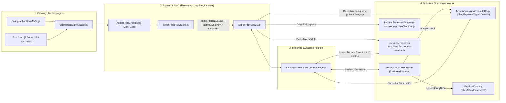

# 🔗 Sincronía entre Banco de Acciones, Asesoría 1-a-1 y WALA

**Versión:** 3.0  
**Última actualización:** Noviembre 2026  
**Alcance:** Exclusivo para **Asesoría WALA 1-a-1** (`ConsultingDashboard.vue` y módulos operativos de WALA). *(No modifica el módulo Juntos / Programas).*

---

## 🎯 Propósito

Este documento define la arquitectura operativa, el catálogo tipado, los flujos contables/UX y las reglas de verificación que conectan el **Banco de Acciones (BA)** del Método WALA con las pantallas y datos reales de la plataforma **WALA**.

El objetivo es garantizar que ninguna acción asignada en una asesoría 1-a-1 quede desconectada como texto estático: cada acción del plan aterrizará en un **parámetro de configuración**, un **registro operativo con deep-link**, una **bitácora de seguimiento** o una **revisión de reporte con evidencia verificable**.

---

## 🏗️ Arquitectura General de Sincronización

---

## 🧩 Los 4 Arquetipos Operativos del Banco de Acciones

Toda acción definida en [actionBankLoader.js](file:///c:/Users/User/Proyectos/wala/apps/web/src/utils/actionBankLoader.js) se enriquece mediante `resolveActionMeta(indicatorKey, trancheKey, row)` en [actionBankMeta.js](file:///c:/Users/User/Proyectos/wala/apps/web/src/config/actionBankMeta.js) con un `actionKey` único (`${indicatorKey}_${tranche}_${num}`, por ejemplo `1.1_0-1_1`) y uno de cuatro arquetipos:

| Arquetipo (`actionType`) | Badge UI | Propósito | Qué renderiza `ActionPlanView.vue` | Dónde persiste en Firestore |
|---|---|---|---|---|
| **`config`** | `Configuración` | Instalación única de una regla, monto o estructura base | Si tiene `configKey`: formulario inline con botón **Guardar en WALA**. Si apunta a Inventario/Costeo: botón directo al módulo | `businesses/{id}/settings/businessProfile` o `businesses/{id}/products` |
| **`habit`** | `Hábito en WALA` | Repetición semanal o por evento dentro de WALA | Badge con métrica real en vivo + botón CTA con deep-link y query params (`preset` / `category` / `type`) | `businesses/{id}/transactions`, `products` o `clients` |
| **`note`** | `Bitácora` | Conversación con el asesor, regla personal, reflexión o acuerdo | Textarea `entrepreneurNote` (y `advisorNote` en modo admin) con prompt específico y botón **Guardar en bitácora** | `businesses/{id}/consulting/dossier` dentro de la acción |
| **`review`** | `Revisión` | Cierre semanal/mensual, análisis de reporte y toma de decisiones | Botón CTA hacia el reporte (`/income-statement`, `/expenses`, `/accounts-receivable`, `/clients`, `/inventory`) + campo de conclusión | `businesses/{id}/consulting/dossier` (`entrepreneurNote`) |

### Estados Oficiales y Retrocompatibilidad
En `actionPlanFlowStore.js` y `ActionPlanView.vue` se soportan tres estados oficiales (`ACTION_STATUS`):
- `in_progress` (**En progreso / Pendiente**) — valores históricos `'incomplete'` se normalizan automáticamente a `'in_progress'`.
- `completed` (**Completada**) — registra `completedAt`.
- `not_done` (**No realizada**) — excluye la acción del bloque *Pendientes* en Resumen y muestra indicador en la vista por ciclo.

---

## 📦 Rutas Operativas y Deep-Links Reales

| Módulo WALA | `targetRoute` en `actionBankMeta.js` | `presetParams` disponibles |
|---|---|---|
| Registro de Egresos / Ingresos | `basicAccountingRecordsBook` | `?type=expense&preset=owner_salary`, `?type=expense&preset=family_salary`, `?type=expense&preset=owner_draw`, `?type=expense&category=materials\|overhead\|labor`, `?type=income` |
| Inventario y Costeo | `inventory` | — |
| Clientes | `clients` | — |
| Cuentas por Cobrar | `accounts-receivable` | — |
| Proveedores | `suppliers` | — |
| Estado de Resultados (P&L) | `income-statement` | — |
| Resumen y Mix de Gastos | `expenses` | — |
| Balance de Cuentas / Caja | `accounts-balance` | — |
| Datos del Negocio (Perfil) | `business-info` | — |
| Dashboard principal | `dashboard` | — |

> [!IMPORTANT]
> [BasicAccountingRecordsWrapper.vue](file:///c:/Users/User/Proyectos/wala/apps/web/src/views/basicAccountingRecords/BasicAccountingRecordsWrapper.vue) lee `route.query.type` al montar para saltar directamente al paso de detalle (`currentStep = 1`), y [StepExpenseType.vue](file:///c:/Users/User/Proyectos/wala/apps/web/src/components/transactionFlow/StepExpenseType.vue) lee `route.query.preset` y `route.query.category` para preseleccionar automáticamente el flujo correspondiente.

---

## 💼 Sincronía del Área 1 (`Negocios y Familia`) en Egresos y P&L

Para resolver la brecha histórica de mezcla entre dinero personal y gastos del negocio, el bloque **Negocio y Dueño (Método WALA)** en [StepExpenseType.vue](file:///c:/Users/User/Proyectos/wala/apps/web/src/components/transactionFlow/StepExpenseType.vue) está visible **para todos los negocios** debajo de las 3 categorías estándar:

| Preset UI | `category` | `subcategory` | `statementLine` / P&L | Flujo de Caja (`CashFlowWidget` / `accountsBalanceStore`) | Proveedor |
|---|---|---|---|---|---|
| **Salario del dueño** | `labor` | `owner_salary` | Según `paylabor`: `cogs_labor` (`DIRECT_SERVICE` / `PRODUCTION_SUPPORT`) u `opex_fixed` (`ADMIN_SUPPORT`, default) | Descuenta Caja o Banco | Opcional (aviso interno en [StepAttachSupplier.vue](file:///c:/Users/User/Proyectos/wala/apps/web/src/components/transactionFlow/StepAttachSupplier.vue)) |
| **Salario a familiares** | `labor` | `family_salary` | Según `paylabor`: `cogs_labor` u `opex_fixed` | Descuenta Caja o Banco | Opcional |
| **Retiro personal del dueño** | `owner_draw` | `personal_withdrawal` | `'owner_draw'` (**excluido** del P&L operativo; mostrado en tarjeta **NO OPERATIVO** bajo `GANANCIA NETA`) | Descuenta Caja o Banco (`tx.type === 'expense'`) | Opcional |

### Tratamiento Contable en Estado de Resultados
1. En [statementLineClassifier.js](file:///c:/Users/User/Proyectos/wala/apps/web/src/utils/statementLineClassifier.js), `owner_draw` y `personal_withdrawal` retornan `'owner_draw'`.
2. En [IncomeStatementView.vue](file:///c:/Users/User/Proyectos/wala/apps/web/src/views/Expenses/IncomeStatementView.vue), `lines` excluye `owner_draw` de los gastos operativos igual que `loan_principal` y `capex`, y el computed `ownerDrawsSummary` consolida estos retiros debajo de la **GANANCIA (UTILIDAD) NETA**, mostrando el desglose y una alerta si superan la ganancia neta del período.
3. En [NavigationBtnBARB.vue](file:///c:/Users/User/Proyectos/wala/apps/web/src/components/basicAccountingRecordsBook/NavigationBtnBARB.vue), la validación del paso `"Adjuntar proveedor"` permite continuar sin proveedor externo cuando la transacción es de categoría `owner_draw` o subcategoría `owner_salary`, `family_salary` o `personal_withdrawal`.

---

## ⚙️ Perfil Financiero y de Gestión Unificado (`settings/businessProfile`)

El documento `businesses/{businessId}/settings/businessProfile` unifica los parámetros de configuración única que alimentan simultáneamente al Plan de Acción y a los módulos operativos:

| Campo | Tipo | Etiqueta en Datos del Negocio | Consumidores en WALA |
|---|---|---|---|
| `ownerSalaryTarget` | `number \| null` | Meta de ingreso personal mensual (S/) | Acción `1.1_0-1_2`, `useActionEvidence` |
| `ownerSalaryAmount` | `number \| null` | Sueldo fijo del dueño asignado (S/) | Pre-llenado en [StepAddExpenseDetails.vue](file:///c:/Users/User/Proyectos/wala/apps/web/src/components/transactionFlow/StepAddExpenseDetails.vue) (`owner_salary`), acciones `1.1_1-2_1`, `1.1_2-3_3`, `1.3_2-3_3` |
| `ownerSalaryFrequency` | `'weekly' \| 'biweekly' \| 'monthly'` | Frecuencia del sueldo | Cálculo automático de valor hora y label de sueldo en egresos |
| `ownerWeeklyHours` | `number \| null` | Horas semanales trabajadas por el dueño | Cálculo de `ownerHourlyRate` en [BusinessInfo.vue](file:///c:/Users/User/Proyectos/wala/apps/web/src/views/business/BusinessInfo.vue) |
| `ownerHourlyRate` | `number \| null` | Valor por hora del dueño (S/ / hr) | Botón **"Usar valor hora del dueño"** en [Step1Card.vue](file:///c:/Users/User/Proyectos/wala/apps/web/src/components/ProductCosting/Step1Card.vue) (Costeo MOD), acciones `5.2_1-2_1` y `5.2_2-3_2` |
| `primaryPromoChannel` | `string` | Canal principal de promoción | Acción `2.2_0-1_2` |
| `purchaseQuoteThreshold` | `number \| null` | Pedir 2+ cotizaciones en compras desde (S/) | Acción `3.1_2-3_1` |
| `cycleMainGoal` | `string` | Meta principal del ciclo actual | Acción `7.3_0-1_1` |

---

## 🔍 Motor de Evidencia Híbrida (`useActionEvidence.js`)

El seguimiento sigue un modelo **híbrido**: WALA calcula evidencia automática y sugiere el completado (`suggestedCompleted: true`), pero el asesor o emprendedor confirma el estado final.

| `evidenceRule.type` | Fuente en Firestore | Qué evalúa | Badge generado |
|---|---|---|---|
| `profile_field_set` | `settings/businessProfile` | Verifica que `rule.field` tenga valor válido (`> 0` o string no vacío) | `Configurado en WALA: S/ X.XX` / `Aún sin configurar en WALA` |
| `tx_subcategory_count` | `transactions` (7d o 30d) | Cuenta egresos con `subcategory` (`owner_salary`, `family_salary`) o `owner_draw` | `Esta semana: N registro(s) (S/ Total)` |
| `tx_count_week` | `transactions` (7d) | Cuenta transacciones del tipo (`income` / `expense`) excluyendo `adjustment` | `Esta semana: N registro(s)` |
| `tx_days_week` | `transactions` (7d) | Cuenta días calendario distintos con registros vs. `minDays` | `Esta semana: D día(s) con registros` |
| `credit_sales_tracked` | `transactions` (30d) | Detecta ventas con `paymentStatus` en `'pending'` o `'partial'` | `Créditos activos (30d): N` |
| `inventory_products_count` | `products` | Cuenta total de productos vs. `minCount` | `Inventario: N producto(s)` |
| `inventory_stock_logs_recent` | `products` | Productos con movimiento/actualización en últimos 30d | `N producto(s) con movimiento reciente` |
| `inventory_min_stock_count` | `products` | Cuenta productos con `minStock > 0` o `safetyStock > 0` | `N producto(s) con stock mínimo` |
| `product_costed_count` | `products` | Cuenta productos con `costStructure` (`materials`, `mod`, `labor`, `cif`, `total`) o `cost > 0` | `N producto(s) costeado(s)` |
| `products_full_costed_ratio` | `products` | Cobertura porcentual de costeo en productos vendibles vs. `minRatio` | `Cobertura costeo: X/Y (Z%)` |
| `waste_logs_month` | `transactions` (30d) | Mermas y faltantes (`category: 'inventory_loss'`) | `Mermas 30d: N registro(s) (S/ Total)` |
| `receivables_with_due_date` | `transactions` (30d) | Créditos activos (`pending`/`partial`) con `promisedPaymentDate` o seguimiento | `N cuenta(s) con fecha o seguimiento` |
| `clients_with_origin_week` | `clients` | Clientes con `originChannel` asignado | `N cliente(s) con canal de origen` |
| `suppliers_count` | `suppliers` | Cuenta proveedores registrados vs. `minCount` | `N proveedor(es) registrado(s)` |
| `purchase_quotes_month` | `purchaseQuotes` (30d) | Comparativas de cotizaciones entre 2+ proveedores | `N cotización(es) comparada(s) (30d)` |
| `supplier_incidents_tracked` | `supplierIncidents` / `suppliers` | Registro híbrido de reclamos, descuentos o devoluciones | `N incidencia(s) / devolución(es) registradas` |
| `projection_created_period` | `projections` | Meta mensual guardada (`salesTarget`, `cogsPctTarget`, `fixedCostsTarget`) | `Proyección YYYY-MM definida en P&L` |
| `recurring_payments_count` | `recurringPayments` | Compromisos fijos mensuales programados en Cuentas | `N pago(s) fijo(s) programado(s)` |
| `note_filled` | `consulting/dossier` | Verifica `entrepreneurNote` no vacío en la acción | `Evidencia anotada en bitácora` |

---

## 💰 Capa Contable No Monetaria, Alertas y Colecciones v3.0

1. **Integridad Caja vs. P&L (`isNonCash: true`, `account: 'non_cash'`):**
   - [nonCashAccounting.js](file:///c:/Users/User/Proyectos/wala/apps/web/src/utils/nonCashAccounting.js) genera egresos contables no monetarios para mermas/faltantes de conteo (`category: 'inventory_loss'`, `statementLine: 'inventory_shrinkage'`) y castigos de incobrables (`category: 'bad_debt'`, `statementLine: 'opex_bad_debt'`).
   - [sharedComputed.js](file:///c:/Users/User/Proyectos/wala/apps/functions/src/AccountsBalance/sharedComputed.js), [accountsBalanceStore.js](file:///c:/Users/User/Proyectos/wala/apps/web/src/stores/AccountsBalanceApp/accountsBalanceStore.js) y [AccountsView.vue](file:///c:/Users/User/Proyectos/wala/apps/web/src/views/Accounts/AccountsView.vue) excluyen estas transacciones del flujo de Caja/Bancos, mientras [IncomeStatementView.vue](file:///c:/Users/User/Proyectos/wala/apps/web/src/views/Expenses/IncomeStatementView.vue) las deduce de la Ganancia Operativa y Ganancia Neta.
2. **Colecciones operativas v3.0 en Firestore (`businesses/{businessId}/...`):**
   - `promoMilestones`: registro de promociones orgánicas (`S/ 0`) y punto de partida hacia gastos de marketing en Libro Contable.
   - `purchaseQuotes`: comparativas de cotizaciones entre 2–3 proveedores y ahorro estimado.
   - `supplierIncidents`: reclamos, notas de crédito (ajuste de `pendingBalance` y saldo de factura) y devoluciones físicas (`stockLog` tipo `'return_to_supplier'`).
   - `projections/{YYYY-MM}`: metas mensuales para **Proyectado vs. Real** en P&L.
   - `recurringPayments`: compromisos fijos mensuales con vencimiento, cálculo de liquidez a 7 días, contingencia (`settings/businessProfile.cashContingencyNote`) y pago en 1 clic pre-llenado.
3. **Toasts accionables (`ToastNotification.vue`, `duration: 4500`):**
   - Alertas con `actionLink` directo al módulo afectado al registrar mermas en inventario, castigar incobrables >30 días, detectar alzas de insumo ≥ 5% (`InventoryEditProductEconomicInfo`) o superar `purchaseQuoteThreshold` sin cotización vinculada.

---

## 🔄 Soporte Multi-Ciclo (`ciclo1`, `ciclo2`, `ciclo3`)

En `businesses/{businessId}/consulting/dossier`:
- `activeCycleKey`: `'ciclo1' | 'ciclo2' | 'ciclo3'` (por defecto `'ciclo1'`).
- `actionPlansByCycle`: `{ ciclo1: ActionItem[], ciclo2: ActionItem[], ciclo3: ActionItem[] }`.
- `actionPlan`: espejo plano del ciclo activo para retrocompatibilidad con vistas y lecturas existentes (`onlyPending` en la pestaña **Resumen** siempre muestra las pendientes del `activeCycleKey`).
- Al migrar expedientes anteriores sin `actionPlansByCycle`, `actionPlan` existente se carga automáticamente dentro de `ciclo1`.

---

## 📋 Checklist de Mantenimiento (Cuando se edite un BA)

1. Mantener el formato de tabla de 4 columnas (`| # | Acción | Frecuencia | Dónde se registra en WALA |`) y los encabezados `## Indicador X.Y` y `### Nivel A → B`.
2. Asegurar que toda referencia en `Dónde se registra en WALA` corresponda a un módulo real (ver Sección 10 de [especificacion_banco_acciones_wala.md](file:///c:/Users/User/Proyectos/wala/apps/web/src/assets/BANCO%20ACCIONES/especificacion_banco_acciones_wala.md)).
3. Si se cambia el comportamiento operativo de una acción o se añade un campo nuevo de perfil/evidencia, actualizar `ACTION_BANK_META` en [actionBankMeta.js](file:///c:/Users/User/Proyectos/wala/apps/web/src/config/actionBankMeta.js) usando la clave `${indicatorKey}_${tranche}_${num}`.
4. Sincronizar los Markdown de `apps/web/src/assets/BANCO ACCIONES/` con `apps/content/src/assets/bancos/` si aplica.
5. Ejecutar la validación de cobertura sobre los 7 BA y `npm run build` en `apps/web`.
