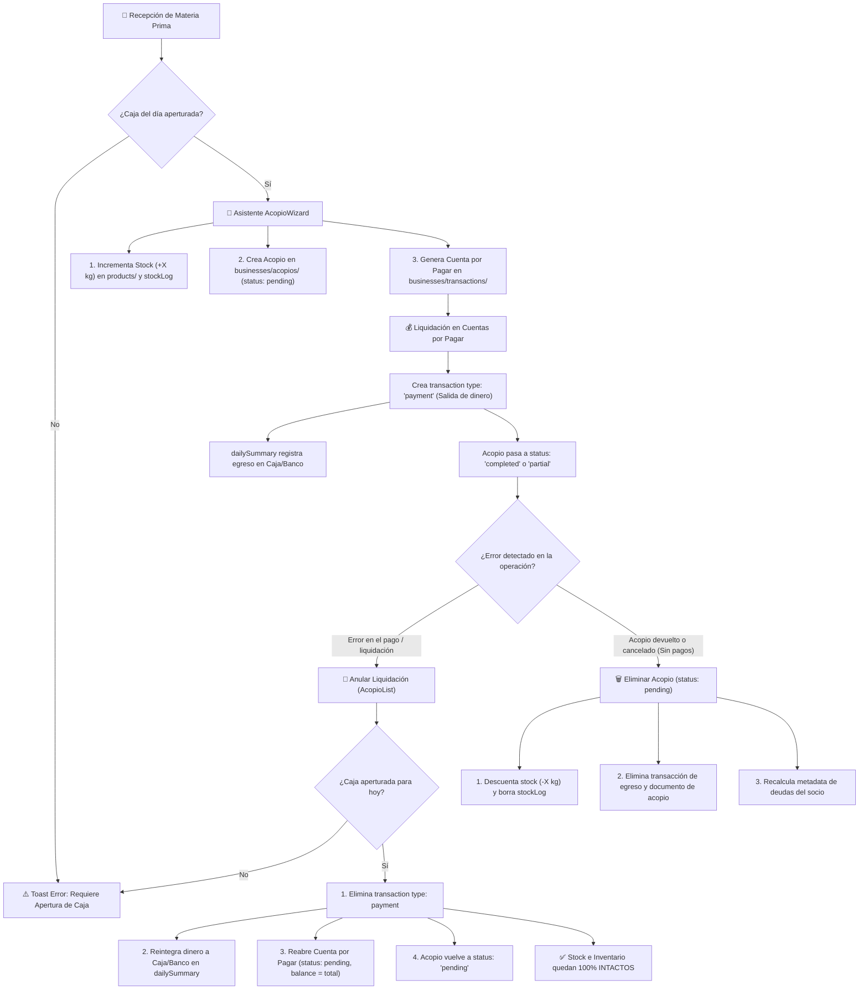

# 🌾 Sistema Integral de Acopio de Productos y Liquidaciones

## 📋 Resumen Ejecutivo

El **Módulo de Acopio** permite a las empresas agrícolas y cooperativas registrar la recepción o acopio de materia prima y mercadería proveniente de socios y productores, gestionando automáticamente:
1. El incremento de existencias en el inventario físico (`products` y subcolección `stockLog`).
2. La generación de la cuenta por pagar (CxP) a nombre del socio (`expense` de categoría `materials`).
3. El seguimiento de precios pactados (fijos o referenciales sujetos a liquidación).
4. La liquidación de pagos y desembolsos desde Caja o Banco a través de Cuentas por Pagar.
5. El flujo de reversión: **Anulación de liquidaciones** (reintegro de dinero sin alterar inventario) vs. **Eliminación de acopios** (reversión física de stock).

---

## 🏗️ Arquitectura y Modelo de Datos

### 1. Documento de Acopio (`businesses/{businessId}/acopios/{acopioId}`)

```typescript
interface AcopioDoc {
  uuid: string;                    // UUID v4 único del acopio
  productId: string;               // UUID del producto acopiado en products/
  productDescription: string;      // Nombre o descripción del producto (ej: "Café Pergamino")
  unit: string;                    // Unidad de medida (ej: "kg", "quintal", "saco")
  quantity: number;                // Cantidad acopiada (ej: 1500)
  agreedPrice: number;             // Precio pactado por unidad (S/.)
  totalAmount: number;             // Monto total = quantity * agreedPrice
  supplierId: string;              // UUID del socio/proveedor
  supplierName: string;            // Razón social o nombre completo del socio
  transactionId: string;           // UUID de la transacción tipo 'expense' enlazada
  status: 'pending' | 'partial' | 'completed'; // Estado de liquidación
  createdAt: Timestamp;            // Fecha de registro
  updatedAt: Timestamp;            // Última modificación
}
```

### 2. Transacción de Egreso (`businesses/{businessId}/transactions/{transactionId}`)

* **`type`**: `'expense'`
* **`category`**: `'materials'`
* **`acopioId`**: Enlace bidireccional al documento de acopio
* **`amount`**: Monto total del acopio
* **`balance`**: Saldo adeudado pendiente de liquidar
* **`totalPaid`**: Monto total liquidado/abonado hasta la fecha
* **`paymentStatus`**: `'pending'` | `'partial'` | `'paid'`
* **`payments`**: Array con el historial de abonos y liquidaciones

---

## 🔒 Regla Crítica: Validación de Apertura de Caja Obligatoria

Para mantener la coherencia contable y prevenir discrepancias con el `dailySummary`, **no se permite registrar acopios ni anular liquidaciones sin antes haber realizado la apertura de caja del día**.

### Composable: `useCashOpeningValidation.js`
* Consulta en tiempo real:
  1. `accountsBalanceStore.openingTransaction` o `dailySummary.hasOpening`.
  2. Llamada asíncrona a `accountsBalanceStore.loadFromDailySummary()`.
  3. Fallback directo a Firestore (`dailySummaries/{today}`).
* Si no hay apertura activa:
  * Emite una notificación mediante `ToastNotification.vue` con enlace interactivo:
    > *"Debes aperturar la caja primero antes de registrar un acopio / anular liquidación. [Aperturar caja ahora](/business/:id/accounts-balance)"*
  * Bloquea la entrada al asistente (`AcopioWizard.vue`), las acciones en `AcopioList.vue` y el botón de inventario (`NavigationBtnInventory.vue`).

---

## 🔄 Flujo Operativo: Registro, Liquidación y Reversión



---

## ⚖️ Diferenciación Fundamental: Anular Liquidación vs. Eliminar Acopio

| Aspecto | 🔄 Anular Liquidación | 🗑️ Eliminar Acopio |
| :--- | :--- | :--- |
| **Condición de aplicación** | Acopios en estado `completed` o `partial` | Acopios en estado `pending` (sin pagos) |
| **Botón en interfaz** | `"Anular Liquidación"` (color ámbar) | `"Eliminar"` (color rojo) |
| **Impacto en Inventario** | **Ninguno**: El stock físico ingresado (`+X kg`) se conserva en el almacén. | **Reversión física**: Se descuenta la cantidad acopiada y se elimina el `stockLog`. |
| **Impacto Financiero** | **Reintegro de dinero**: La salida de dinero se anula; los fondos retornan a Caja o Banco en el `dailySummary`. | **Anulación de deuda**: Se elimina la obligación por pagar registrada con el socio. |
| **Impacto en CxP** | **Reapertura de deuda**: El egreso vuelve a `balance = totalAmount` y `paymentStatus = 'pending'`, visible en Cuentas por Pagar. | **Eliminación**: La transacción de egreso se borra completamente. |
| **Documento de Acopio** | **Se conserva**: Su estado regresa a `pending`, listo para reajustar precio o liquidarse de nuevo. | **Se elimina**: El documento es borrado de Firestore. |
| **Requiere Apertura de Caja** | **Sí obligatoria**: Al retornar dinero a la empresa, hay un flujo monetario activo. | **No obligatoria**: No involucra movimiento de efectivo ni cuentas financieras. |

---

## 🛠️ Métodos y API Técnica

### 1. `useAcopios.js`

* **`saveAcopio(acopioData)`**:
  * Valida caja aperturada.
  * Crea documento en `acopios/`.
  * Genera egreso en `transactions/` (`category: 'materials'`, `source: 'acopio'`).
  * Agrega registro a `products/{id}/stockLog` e incrementa el campo `stock`.
* **`updateAcopioPriceAndExpense(acopioId, newPrice)`**:
  * Actualiza `agreedPrice` y `totalAmount` en el documento de acopio.
  * Actualiza `amount`, `balance` y costos de `materialItems` en la transacción.
  * Recalcula `pendingBalance` en el socio (`supplierStore.updateSupplierMetadata`).
* **`revertAcopioLiquidation(acopioId)`**:
  * Valida caja aperturada del día.
  * Busca y elimina documentos `type: 'payment'` asociados al `transactionId`.
  * Restablece la transacción de egreso con `balance = totalAmount`, `totalPaid = 0`, `paymentStatus = 'pending'`.
  * Actualiza el acopio a `status: 'pending'`.
  * Actualiza la metadata de deudas del socio en `supplierStore`.
  * Recarga `accountsBalanceStore.loadFromDailySummary()`.
* **`deleteAcopio(acopioId)`**:
  * **Guardián de integridad:** Lanza excepción si el acopio tiene estado `completed` o `partial`.
  * Descuenta el stock físico de `products/{id}` y borra su `stockLog`.
  * Elimina la transacción de egreso mediante `transactionStore.deleteOneTransactionByID()`.
  * Elimina físicamente el documento de acopio.
  * Actualiza la metadata del socio.

### 2. `acopioStore.js`

* **`fetchAcopios()`**: Suscripción en tiempo real a la colección de acopios del negocio.
* **`registerNewAcopio(payload)`**: Wrapper de registro que actualiza estado de carga.
* **`updateAcopioPrice(acopioId, newPrice)`**: Actualiza precio pactado en store y backend.
* **`revertLiquidation(acopioId)`**: Invoca la reversión y conmuta el estado local a `pending`.
* **`deleteAcopio(acopioId)`**: Invoca la eliminación y retira el elemento del array reactivo `acopios`.

---

## 🎯 Caso de Uso Práctico

1. **Recepción:** El productor Juan Pérez entrega 500 kg de café a S/ 8.00/kg (Total: S/ 4,000.00). El almacén recibe el café y el stock aumenta en 500 kg. Se genera la deuda por S/ 4,000.00.
2. **Liquidación errónea:** Tesorería registra la liquidación completa de los S/ 4,000.00 usando la cuenta "Caja Efectivo", pero en realidad el socio debía recibir una transferencia bancaria que aún no se firmaba.
3. **Corrección:**
   * El usuario va a **Acopio de Productos** y ve el acopio de Juan Pérez como **Liquidado**.
   * Presiona el botón **"Anular Liquidación"**.
   * El sistema valida que la caja esté abierta y muestra el modal informativo.
   * Al confirmar:
     * Los S/ 4,000.00 regresan a la "Caja Efectivo" de la empresa (se anula el pago).
     * El inventario sigue teniendo los 500 kg de café (no se descuentan).
     * El acopio vuelve a estado **Deuda Pendiente**.
     * Juan Pérez vuelve a tener la deuda de S/ 4,000.00 en **Cuentas por Pagar**, lista para ser pagada correctamente vía Transferencia Bancaria.
